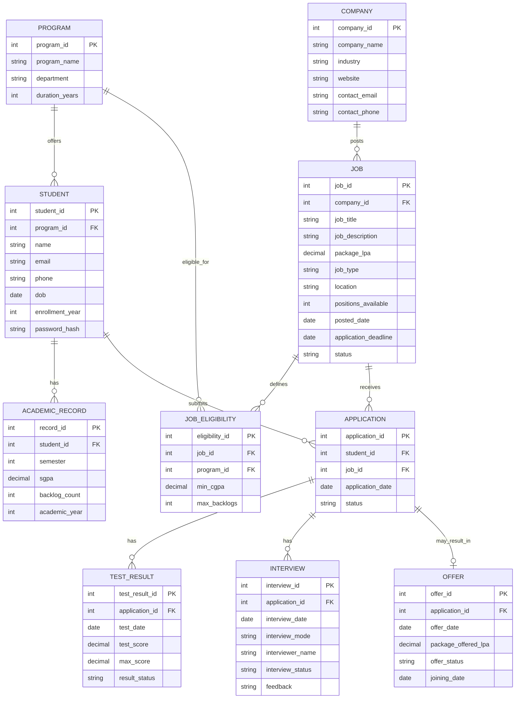

# Group 10 — University Placement and Recruitment Management System
## Requirement Analysis & Conceptual (ER) Design
### Member 1 Deliverable — Phase I & Phase II

---

## 1. Problem Statement

The university placement cell currently manages job postings, student eligibility,
applications, tests, interviews, and offers manually or through disconnected
spreadsheets. This causes delays, eligibility errors, and poor visibility into
placement statistics. We need a centralized, database-driven web application
where companies' job requirements are matched automatically against student
academic records, and the entire recruitment pipeline (application -> test ->
interview -> offer) is tracked in one system with real-time dashboards.

---

## 2. Stakeholders

| Stakeholder | Role in system |
|---|---|
| Student | Views eligible jobs, applies, tracks application status |
| Placement Officer (Admin) | Posts jobs, sets eligibility rules, shortlists, schedules tests/interviews, records offers |
| Company | Provides job requirements (managed by admin on their behalf) |
| Faculty/Department | Views branch-wise placement statistics (read-only) |

---

## 3. Functional Requirements

1. Student registration and login; admin login (role-based access)
2. Admin can create/update/delete company and job records
3. System automatically checks a student's eligibility for each job (CGPA,
   backlog count, branch) using a stored procedure/function
4. Student can view only jobs they are eligible for, and apply
5. Admin can record test results for applications
6. Admin can schedule and record interview outcomes
7. Admin can generate offers for selected students
8. Dashboard shows placement statistics: total placed, average package,
   company-wise and branch-wise placement counts
9. Search, filter, and sort jobs/applications (by branch, package, company, status)
10. Input validation on all forms (no duplicate applications, valid CGPA ranges, etc.)

---

## 4. Non-Functional Requirements

- **Security:** hashed passwords, role-based access control, parameterized SQL
  queries (no SQL injection)
- **Performance:** indexes on frequently searched columns (student email, job status)
- **Reliability:** foreign key constraints + transactions so an offer and
  application-status update happen atomically
- **Usability:** responsive interface, clear error messages
- **Maintainability:** modular Python (Flask) code, documented schema
- **Portability:** deployable on a cloud host with a public URL

---

## 5. Business Rules

- A student can apply to a job **only if eligible** (branch matches
  `JOB_ELIGIBILITY`, CGPA >= minimum, backlogs <= maximum)
- A student **cannot apply twice** to the same job
- A job cannot be applied to after its `application_deadline`
- Test results and interviews are recorded only against an existing application
- An offer can be created only after a completed interview with a positive outcome
- Application status flows: `Applied -> Shortlisted -> Interviewed -> Selected/Rejected`

---

## 6. Entities and Key Attributes

| Entity | Key Attributes |
|---|---|
| **PROGRAM** | program_id (PK), program_name, department, duration_years |
| **STUDENT** | student_id (PK), program_id (FK), name, email, phone, dob, enrollment_year, password_hash |
| **ACADEMIC_RECORD** | record_id (PK), student_id (FK), semester, sgpa, backlog_count, academic_year |
| **COMPANY** | company_id (PK), company_name, industry, website, contact_email, contact_phone |
| **JOB** | job_id (PK), company_id (FK), job_title, job_description, package_lpa, job_type, location, positions_available, posted_date, application_deadline, status |
| **JOB_ELIGIBILITY** | eligibility_id (PK), job_id (FK), program_id (FK), min_cgpa, max_backlogs |
| **APPLICATION** | application_id (PK), student_id (FK), job_id (FK), application_date, status |
| **TEST_RESULT** | test_result_id (PK), application_id (FK), test_date, test_score, max_score, result_status |
| **INTERVIEW** | interview_id (PK), application_id (FK), interview_date, interview_mode, interviewer_name, interview_status, feedback |
| **OFFER** | offer_id (PK), application_id (FK), offer_date, package_offered_lpa, offer_status, joining_date |

**Design note:** `JOB_ELIGIBILITY` is kept separate from `JOB` because a single
job may be open to multiple branches with different cutoffs (e.g., CSE needs
CGPA >= 7, ECE needs >= 7.5). Each eligible branch gets its own row instead of
packing multiple values into one field. This avoids repeating groups and sets
up clean normalization in Phase III/IV.

---

## 7. Relationships and Cardinalities

- PROGRAM (1) --- (M) STUDENT
- STUDENT (1) --- (M) ACADEMIC_RECORD
- COMPANY (1) --- (M) JOB
- JOB (1) --- (M) JOB_ELIGIBILITY
- PROGRAM (1) --- (M) JOB_ELIGIBILITY
- STUDENT (1) --- (M) APPLICATION
- JOB (1) --- (M) APPLICATION  *(resolves the natural Student <-> Job many-to-many)*
- APPLICATION (1) --- (M) TEST_RESULT  *(a student may take multiple test rounds)*
- APPLICATION (1) --- (M) INTERVIEW  *(HR round, technical round, etc.)*
- APPLICATION (1) --- (0 or 1) OFFER  *(not every application results in an offer)*

---

## 8. ER Diagram

*(This Mermaid diagram renders automatically when viewed on GitHub. It can also
be exported as an image using any Mermaid live editor for the project report.)*

---

## 9. Handoff to Member 2

This document provides the entities, attributes, relationships, and business
rules needed for Member 2 to:
- Convert this ER model into the relational schema (tables with explicit PK/FK/constraints)
- Build the data dictionary
- Carry out 1NF -> 2NF -> 3NF normalization